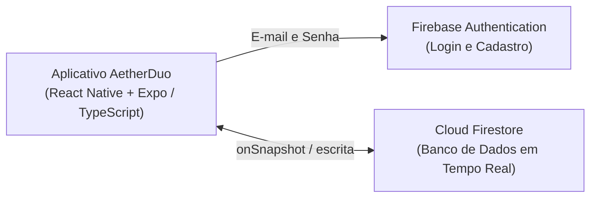

# Arquitetura do Sistema — AetherDuo

## 1. Visão Geral
O **AetherDuo** utiliza uma arquitetura simples cliente-nuvem (**BaaS — Backend as a Service**): o aplicativo feito em **React Native + Expo** se comunica diretamente com os serviços do **Firebase** (Authentication e Cloud Firestore), sem necessidade de manter um servidor próprio.

---

## 2. Organização dos Arquivos

| Arquivo / Pasta | Responsabilidade |
| :--- | :--- |
| `App.tsx` | Raiz do aplicativo: controla carregamento, troca entre tela de login e abas principais (`Hábitos` e `✦ Dupla`). |
| `src/firebase.ts` | Inicializa a conexão com o Firebase e exporta `auth` e `db`. |
| `src/auth.tsx` | Gerencia sessão (`AuthProvider`), criação de perfil, login, cadastro, logout e mensagens de erro. |
| `src/data.ts` | Hooks em tempo real (`onSnapshot`) e funções de gravação/atualização no Firestore. |
| `src/screens/AuthScreen.tsx` | Tela de login e criação de conta. |
| `src/screens/HabitsScreen.tsx` | Tela de hábitos do usuário, barra de progresso e recebimento de empurrões. |
| `src/screens/DuoScreen.tsx` | Tela de convites (sem dupla) e acompanhamento do parceiro (com dupla). |
| `src/components.tsx` | Componentes reutilizáveis: `Button`, `Card` e `ProgressBar`. |
| `src/theme.ts` | Paleta de cores padrão do aplicativo. |
| `src/dates.ts` | Geração e atualização automática da data local (`YYYY-MM-DD`). |
| `src/alert.ts` | Alertas e confirmações compatíveis com Web, Android e iOS. |
| `src/types.ts` | Definição dos tipos TypeScript (`Profile`, `Habit`, `Invite`, `Nudge`). |
| `firestore.rules` | Regras de acesso do banco de dados (exige usuário autenticado). |

---

## 3. Estrutura do Banco de Dados (Cloud Firestore)

O banco armazena os dados em **5 coleções**:

1. **`users/{uid}`** — perfil de cada usuário:
   - `email`, `emailLower`, `partnerUid` (`string | null`), `createdAt`.
2. **`habits/{habitId}`** — hábitos cadastrados:
   - `ownerUid`, `title`, `createdAt`.
3. **`checks/{uid}_{habitId}_{date}`** — marcações de conclusão diária:
   - `ownerUid`, `habitId`, `date` (`YYYY-MM-DD`).
4. **`invites/{fromUid}__{toEmail}`** — convites de dupla:
   - `fromUid`, `fromEmail`, `toEmail`, `status` (`pending`, `accepted` ou `declined`).
5. **`nudges/{fromUid}_{toUid}_{date}`** — empurrões enviados no dia:
   - `fromUid`, `toUid`, `fromEmail`, `date`, `seen` (`boolean`).
