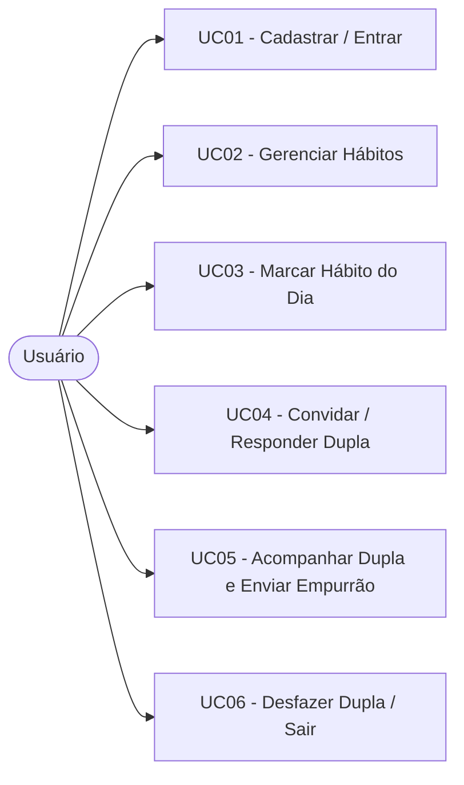

# Casos de Uso — AetherDuo

## 1. Atores
- **Usuário:** pessoa autenticada que gerencia seus hábitos e pode formar uma dupla.
- **Parceiro (Dupla):** outro usuário autenticado conectado ao usuário principal.

---

## 2. Diagrama Geral

---

## 3. Descrição dos Casos de Uso

### UC01 — Cadastrar e Entrar no Aplicativo
- **Ator:** Usuário
- **Fluxo principal:**
  1. O usuário abre o aplicativo e visualiza a tela de login.
  2. Informa e-mail e senha e clica em **Entrar** (ou alterna para **Criar conta**).
  3. O sistema valida os dados no Firebase Authentication e libera o acesso às abas principais.

### UC02 — Gerenciar Hábitos Diários
- **Ator:** Usuário
- **Fluxo principal:**
  1. Na aba **Hábitos**, o usuário digita o nome do hábito no campo inferior e toca em **`+`**.
  2. O sistema salva o hábito no Firestore e exibe na lista.
  3. Para remover, o usuário pressiona e segura o hábito e confirma a exclusão.

### UC03 — Marcar Hábito Concluído no Dia
- **Ator:** Usuário
- **Fluxo principal:**
  1. O usuário toca sobre um hábito da sua lista.
  2. O sistema registra (ou remove) a marcação da data atual no Firestore e atualiza a barra de progresso.

### UC04 — Convidar e Formar Dupla
- **Ator:** Usuário e Parceiro
- **Fluxo principal:**
  1. Na aba **✦ Dupla**, o usuário informa o e-mail do amigo e toca em **Enviar convite**.
  2. O amigo visualiza o convite em **Convites recebidos** e toca em **Aceitar**.
  3. O sistema vincula os dois perfis ao mesmo tempo e passa a exibir o painel da dupla.
- **Fluxos alternativos:** quem enviou pode cancelar o convite; quem recebeu pode recusar.

### UC05 — Acompanhar Parceiro e Enviar Empurrão
- **Ator:** Usuário
- **Fluxo principal:**
  1. Na aba **✦ Dupla**, o usuário visualiza quantos hábitos o parceiro concluiu hoje e quais ainda faltam.
  2. Caso o parceiro ainda tenha hábitos pendentes, o usuário toca em **Dar um empurrão**.
  3. O parceiro recebe um aviso amarelo no topo da aba **Hábitos** e pode tocar nele para dispensar.

### UC06 — Desfazer Dupla ou Sair da Conta
- **Ator:** Usuário
- **Fluxo principal:**
  1. Na aba **✦ Dupla**, o usuário toca em **Desfazer dupla** e confirma a ação; os perfis são desvinculados.
  2. Na aba **Hábitos**, o usuário pode tocar em **Sair** para encerrar a sessão e voltar à tela de login.
